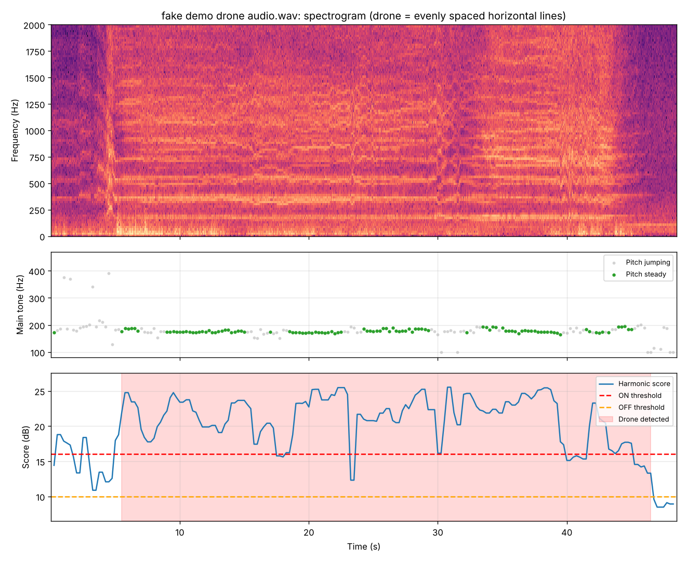
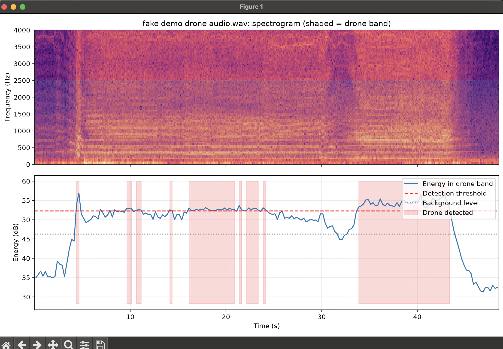
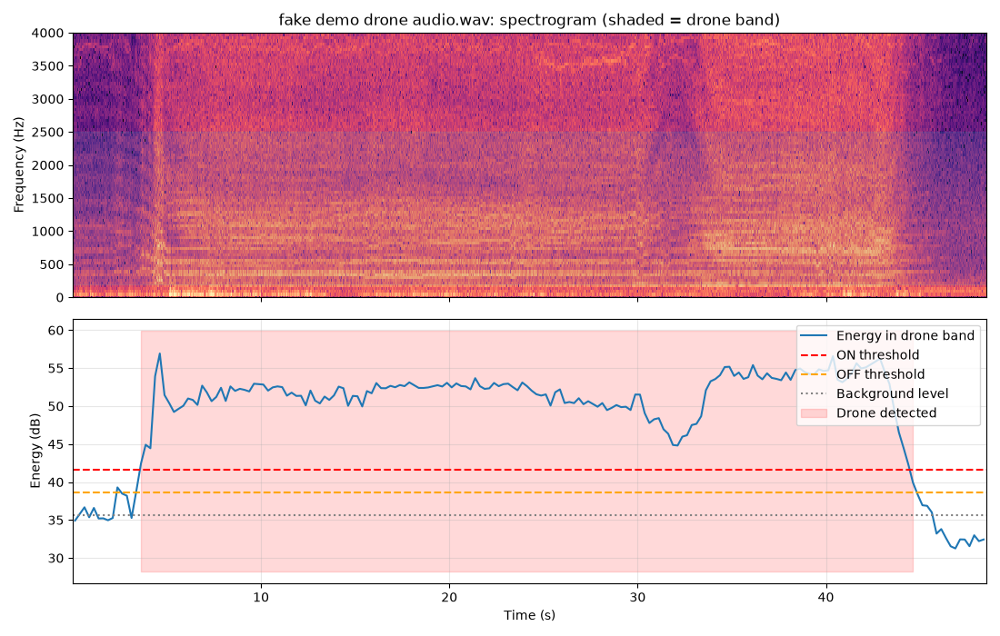
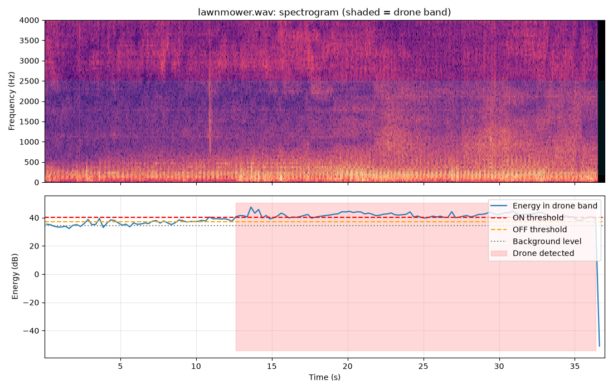
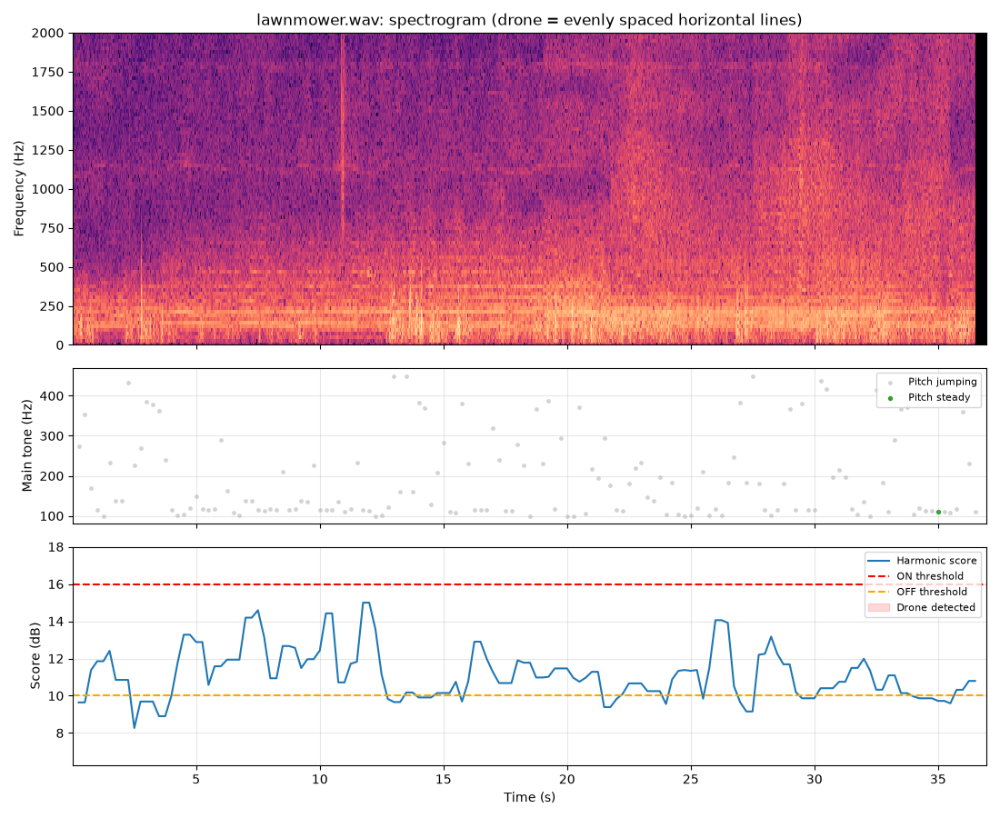
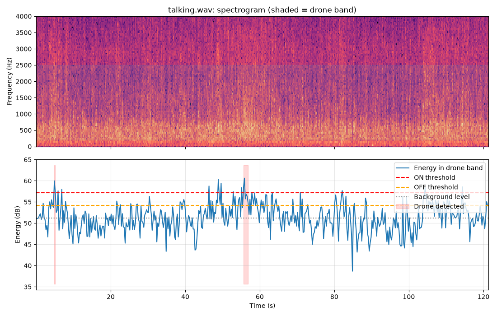
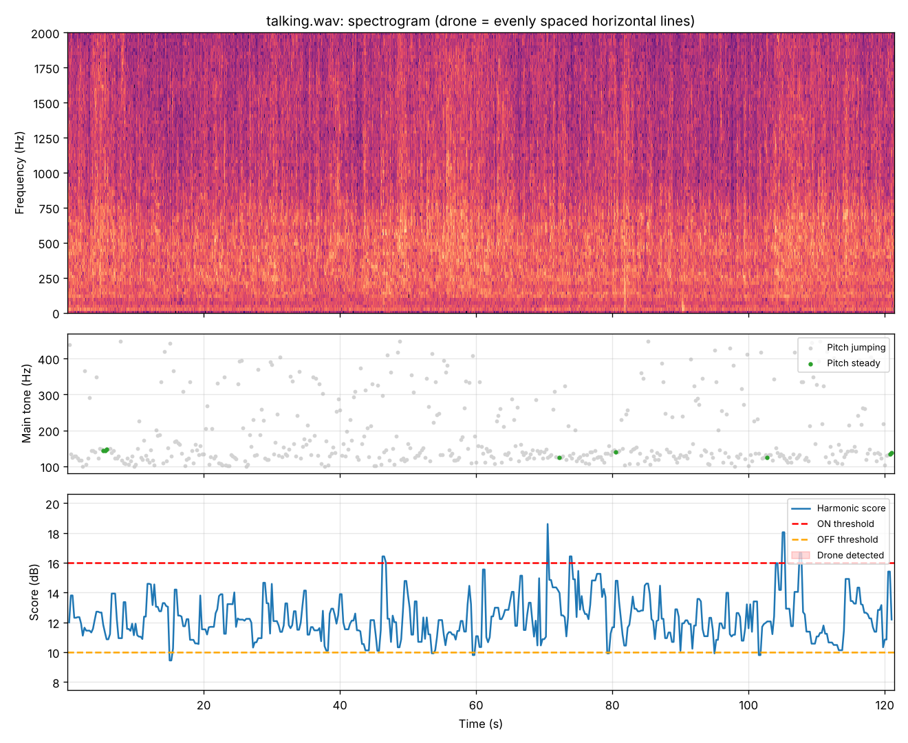
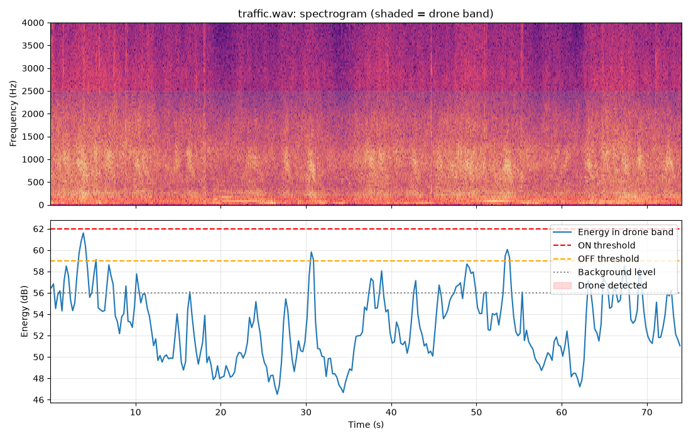
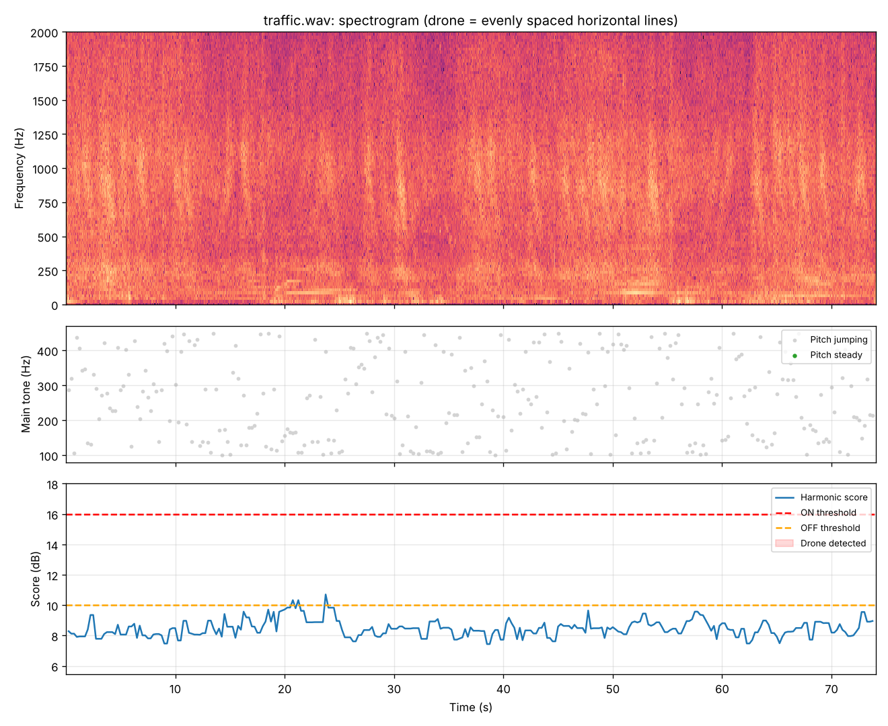

# Drone Detection & Tracking Turret 🎯

A low-cost system that **hears a drone** with a microphone array, **swings a camera toward it**, and then **locks on visually** with a pan-tilt turret, using sound first and sight second.

> **Status:** 🟡 In progress, Part A (acoustic detector)

<!-- Replace with your best photo, render, or GIF once you have one -->
<!--  -->

---

## 🎯 Goal
Detect a small drone by its propeller sound, estimate which direction it's coming from, hand that bearing to a camera turret, and keep the drone centered in frame, then measure detection range, bearing accuracy, and tracking error.

## ⚙️ How it works
1. **Hear:** a 4-mic array on a Raspberry Pi listens for the drone's propeller buzz, recognized by its harmonic pattern: a steady main tone (~100–450 Hz) plus evenly spaced harmonics.
2. **Locate:** the SRP-PHAT algorithm compares tiny arrival-time differences between the mics to estimate the drone's bearing.
3. **Point:** the bearing commands the pan servo to swing the camera toward the sound.
4. **Lock on:** OpenCV finds the target in the camera frame, and a control loop keeps it centered.

## 🗺️ Roadmap
- [ ] **Part A: Acoustic detector:** detection + direction finding; calibrate bearing error at 30° increments
- [ ] **Part B: Tracking turret:** pan-tilt camera mount, OpenCV target tracking, controller tuning
- [ ] **Part C: Combined system:** acoustic cue hands off to the camera, which takes over tracking
- [ ] **Testing & write-up:** detection range, bearing accuracy, tracking error, response time

## 📈 Progress log
| Date | Milestone | Notes |
|------|-----------|-------|
| 11/04/2026 | Project started | Defined scope and roadmap |
| 11/04/2026 | Built laptop acoustic detection script | Flags drone buzz by sound energy in the 200–2500 Hz band vs. background; validated on synthetic drone audio |
| 11/04/2026 | First test on a 48 s drone recording | Detection flickered on and off; diagnosed the cause and fixed it (see below) |
| 11/04/2026 | Re-tested with fix | One continuous detection from ~3.6 s to ~44.7 s, held through a dip at ~32 s |
| 11/05/2026 | Decoy test (lawnmower, talking, traffic) | v2 rejected 0 of 3 for the right reason: lawnmower 24 s false alarm, talking 2 false alarms, traffic passed only because its background estimate was inflated |
| 11/05/2026 | v3: harmonic detection | Switched from loudness to harmonic pattern + steady pitch; drone still detected, all 3 decoys rejected |
| | | |

## 📊 Results
### Acoustic detection, v3 ([code](acoustic/drone_detect_laptop.py))
For each 0.5 s frame, the detector tries every candidate main tone from 100–450 Hz and scores how much the spectrum sticks out **at** its harmonics (1×–5×) versus **between** them. A drone is declared only when the score is high **and** the main tone stays within 8% for at least 1 s. Detection then holds until the score drops below a lower OFF level (hysteresis).

| Clip | v2 (loudness) | v3 (harmonic + steady pitch) |
|---|---|---|
| Drone (48 s) | ✅ detected | ✅ detected, 5.4–46.6 s |
| Lawnmower (37 s) | ❌ 24 s false alarm | ✅ rejected |
| Talking (121 s) | ❌ 2 false alarms | ✅ rejected |
| Traffic (74 s) | ⚠️ passed for the wrong reason | ✅ rejected |


*Top: spectrogram, where the drone shows as evenly spaced horizontal lines. Middle: estimated main tone; green = steady (drone-like). Bottom: harmonic score vs. ON/OFF thresholds.*

**Known limits:** tested on only 4 clips, so the thresholds aren't proven on a larger set. A steady machine whine (fan motor, electrical hum) also makes a steady harmonic tone and could still cause false alarms; that's the next test.

*Coming soon:* bearing error vs. true angle, detection range, and tracking error over time.

## 🧰 Tech stack
- **Software:** Python, NumPy, SciPy, sounddevice, pyroomacoustics (SRP-PHAT), OpenCV
- **Hardware:** Raspberry Pi, 4-mic array board, Pi camera, pan-tilt servo mount
- **CAD:** SolidWorks / Fusion 360

## 📁 Repository structure
```
drone-tracking-turret/
├── acoustic/     # detection & direction finding (drone_doa.py)
├── turret/       # camera tracking & servo control
├── combined/     # acoustic-to-camera handoff
├── hardware/     # CAD files, wiring diagrams
├── data/         # recordings & test logs
├── media/        # photos, videos, plots
└── README.md
```

## 🧠 What I'm learning
<!-- Update as you go: problems you hit and how you solved them. Recruiters read this. -->
- **Background estimation (11/04):** On my first test with a 48-second drone recording, the detector flickered on and off even though the drone was audible the whole time. The cause: the script estimated background noise from the quietest 20% of the clip, but the drone was present for ~80% of it, so the "background" already included drone sound. That pushed the threshold up to the drone's own level, and every small wobble crossed it.
  - **Fix 1:** learn the background from the first 3 seconds (drone-free), the same calibration step the Raspberry Pi version will use.
  - **Fix 2:** hysteresis, meaning separate ON (+6 dB) and OFF (+3 dB) thresholds, so small level changes near the line don't toggle the detection.
  - **Result:** background dropped from ~46 dB to ~35.5 dB, and the detector now gives one continuous detection for the whole time the drone is present, even through a ~6 dB dip.

  | Before (flickering) | After (fixed) |
  |---|---|
  |  |  |

  - **Takeaway:** a detector is only as good as its noise reference.
- **Loudness isn't enough (11/05):** I tested v2 on three decoys: a lawnmower, people talking, and traffic. It failed all three. The lawnmower got louder partway through and was flagged as a drone for 24 s. Two loud syllables in a row triggered false alarms on speech. Traffic didn't trigger, but only because the clip opened with a loud car, which inflated the background estimate; later cars peaked above what a quiet-start background would have allowed.
  - **What I changed:** stopped asking "how loud is it?" and started asking "what does it sound like?" The drone's spectrogram shows a stack of evenly spaced harmonic lines with a steady main tone (~175–190 Hz). Speech and traffic don't have that, and the lawnmower's pattern isn't steady. v3 requires a strong harmonic pattern plus a steady pitch for 1 s, so it no longer depends on background calibration at all.
  - **Result:** drone still detected; all three decoys rejected. Results held across a range of thresholds (ON 14–16, OFF 10–11), which suggests they aren't tuned to one lucky value.

  | Decoy | v2 (loudness) | v3 (harmonic) |
  |---|---|---|
  | Lawnmower |  |  |
  | Talking |  |  |
  | Traffic |  |  |

  - **Takeaway:** a good detector looks for what makes the target *different*, not just what makes it loud. Next: test steady machine noise (fans, hums) and more drone recordings.

## ⚠️ Scope
This is a passive detection and tracking system only. It carries no effector and does not interfere with any aircraft. Testing uses recorded drone audio and indoor sub-250 g drones; any outdoor flights follow FAA recreational rules outside restricted airspace.

---
*Built by Mat Yohannes · Mechanical Engineering, Howard University*
