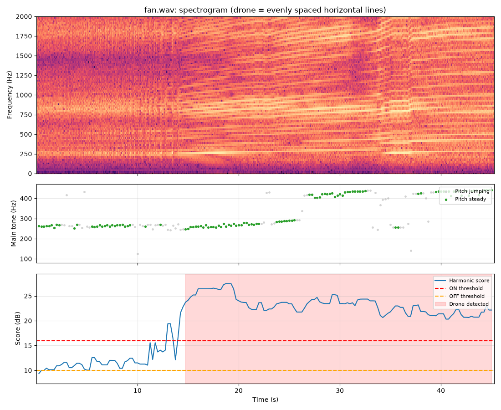

# Drone Detection and Tracking Turret

A low-cost system that detects a small drone by sound, estimates its direction with a microphone array, and hands that bearing to a pan-tilt camera turret that locks on and tracks it visually.

**Status:** In progress. The acoustic detection algorithm is prototyped and tested in Python on recorded audio. Hardware (Raspberry Pi, microphone array, turret) has not been built yet.

## How it works

1. **Detect:** a microphone listens for propeller noise. Drone propellers produce a steady fundamental tone (the blade-pass frequency, roughly 100–450 Hz) with evenly spaced harmonics, and the detector looks for that pattern.
2. **Locate:** a 4-microphone array estimates the direction of the sound from arrival-time differences between microphones (SRP-PHAT).
3. **Point:** the bearing drives the pan servo to turn the camera toward the source.
4. **Confirm and track:** the camera identifies the target and a control loop keeps it centered in the frame.

Steps 2–4 are planned. Step 1 is implemented and tested (see Results).

## Results: acoustic detection

Code: [`acoustic/drone_detect_laptop.py`](acoustic/drone_detect_laptop.py)

For each 0.5 s frame, the detector tests candidate fundamental frequencies from 100–450 Hz and scores how much stronger the spectrum is at the first five harmonics than between them. A detection requires a high harmonic score and a fundamental that stays within 8% for at least 1 s. Once triggered, detection holds until the score falls below a lower threshold (hysteresis).

| Clip | Length | v2 (loudness-based) | v3 (harmonic + pitch stability) |
|---|---|---|---|
| Drone | 48 s | Detected | Detected, 5.4–46.6 s |
| Lawnmower | 37 s | False alarm, 24 s | No detection |
| Speech | 121 s | 2 false alarms | No detection |
| Traffic | 74 s | No detection (for the wrong reason, see notes) | No detection |
| Fan | 45 s | Not tested | False alarm, ~30 s |


*Top: spectrogram; the drone appears as evenly spaced horizontal lines. Middle: estimated fundamental frequency, green where stable. Bottom: harmonic score against the on/off thresholds, with detections shaded.*

## Known limitations

- **Fans and other bladed machines.** The detector responds to spinning-blade noise, not to drones specifically. A fan produces the same harmonic structure with a stable fundamental (~260–290 Hz, then ~420–440 Hz after a speed change) and triggered a ~30 s false alarm. Because a fan and a drone are both motors driving blades, this is a limit of single-sensor acoustic detection rather than a tuning problem.
- **Small test set.** Results are based on one drone recording and four non-drone recordings. I did not tune the detector to reject the fan clip: with a single drone recording, a rule that separates that fan from that drone may not generalize.
- **How the design addresses it.** Acoustic detection is used as a cue, not a final decision. The bearing points the camera, and visual confirmation decides whether the target is a drone. Fielded counter-UAS systems pair acoustic sensing with a second sensor for the same reason.
- **Next step.** Collect more drone recordings (different airframes, distances, outdoor conditions) and more motor/fan recordings before attempting acoustic-only discrimination.

## Development log

| Date | Milestone | Notes |
|---|---|---|
| 11/04/2026 | Project started | Defined scope and roadmap |
| 11/04/2026 | v1 detector | Energy in the 200–2500 Hz band compared to background; validated on synthetic audio |
| 11/04/2026 | First test on real drone audio | Detection flickered on and off; see engineering notes |
| 11/04/2026 | v2 detector | Start-of-clip noise calibration and hysteresis; one continuous detection (~3.6–44.7 s) |
| 11/05/2026 | Decoy test | v2 failed all three decoys (lawnmower, speech, traffic) |
| 11/05/2026 | v3 detector | Harmonic pattern and pitch stability; drone detected, all three decoys rejected |
| 11/05/2026 | Fan test | v3 false alarm on a fan; documented as a known limitation |

## Engineering notes

### Noise estimation (v1 to v2)

On the first real recording, detection switched on and off repeatedly while the drone was audible the whole time. The background level was estimated from the quietest 20% of frames, but the drone was present for about 80% of the clip, so the background estimate already included drone noise. That raised the threshold to the drone's own level, and small fluctuations crossed it.

Changes:
- Estimate background from the first 3 s of the recording, which is drone-free. The Raspberry Pi version will use the same calibration step.
- Add hysteresis: separate on (+6 dB) and off (+3 dB) thresholds, so small level changes near the threshold do not toggle the output.

Result: background estimate dropped from ~46 dB to ~35.5 dB, and the detector produced one continuous detection, including through a ~6 dB dip.

| Before | After |
|---|---|
|  |  |

### Loudness is not enough (v2 to v3)

v2 was tested against three non-drone recordings and failed all three:
- **Lawnmower:** got louder partway through and was flagged as a drone for 24 s.
- **Speech:** two loud syllables in a row triggered short false alarms.
- **Traffic:** no alarm, but only because the clip opened with a loud vehicle, which inflated the background estimate. Later vehicles exceeded what a quiet-start background would have allowed.

The drone spectrogram shows a stack of evenly spaced harmonics with a steady fundamental (~175–190 Hz). Speech and traffic lack that structure, and the lawnmower's pattern is not stable. v3 replaces the loudness test with a harmonic score plus a pitch-stability requirement, which also removes the dependence on background calibration.

Result: the drone is still detected and all three decoys are rejected. The outcome held across a range of thresholds (on: 14–16, off: 10–11), so it does not depend on one specific setting.

| Decoy | v2 (loudness) | v3 (harmonic) |
|---|---|---|
| Lawnmower |  |  |
| Speech |  |  |
| Traffic |  |  |

### Fan test (v3)

A fan was the next logical decoy because it is steady machine noise. v3 flagged it as a drone for ~30 s. Before ~15 s the harmonic pattern was too weak to trigger; once the fan was louder, the score rose above 20 and stayed there.



I documented this as a known limitation instead of adjusting thresholds to reject one clip. With one drone recording, there is no way to tell whether a new rule separates drones from fans in general or only this drone from this fan. This result is the main reason the system design includes camera confirmation.

## Roadmap

- [ ] **Part A: Acoustic detector.** Detection (prototyped) and direction finding; calibrate bearing error at 30° increments
- [ ] **Part B: Tracking turret.** Pan-tilt camera mount, visual target tracking, controller tuning
- [ ] **Part C: Integrated system.** Acoustic bearing cues the camera, which takes over tracking
- [ ] **Testing.** Detection range, bearing accuracy, tracking error, response time

## Hardware and software

- **Software:** Python, NumPy, SciPy, Matplotlib; planned: pyroomacoustics (SRP-PHAT), OpenCV
- **Planned hardware:** Raspberry Pi, 4-microphone array, Pi camera, pan-tilt servo mount
- **CAD:** SolidWorks / Fusion 360

## Repository layout

```
drone-tracking-turret/
├── acoustic/     detection and direction finding
├── media/        plots, photos, and videos
├── turret/       camera tracking and servo control (planned)
├── combined/     acoustic-to-camera handoff (planned)
├── hardware/     CAD files and wiring diagrams (planned)
├── data/         recordings and test logs (planned)
└── README.md
```

## Scope

This is a passive detection and tracking system. It has no effector and does not interfere with any aircraft. Testing uses recorded audio; any flight testing will follow FAA recreational rules outside restricted airspace.

---
Mathew Yohannes, Mechanical Engineering, Howard University
